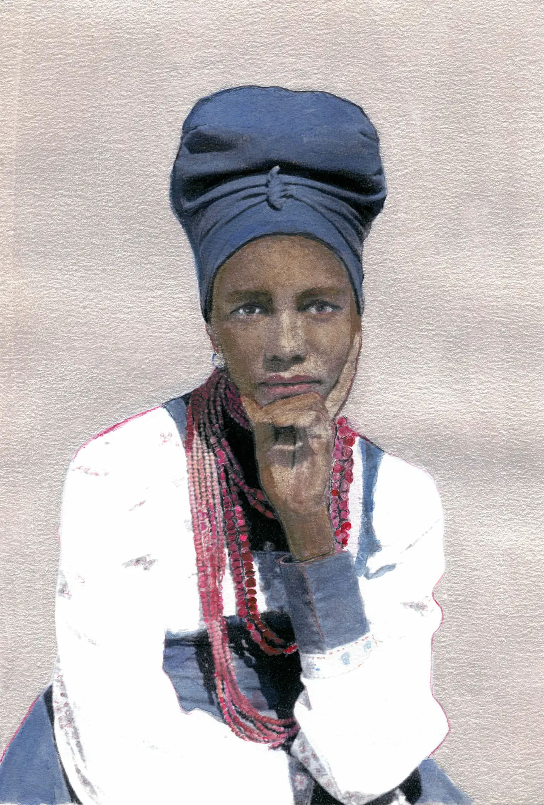

On December 10, we are organizing a public lecture by Anette Hoffmann, entitled “Echo Travels: Re-Circulating Historical Voice Recordings That Speak of Colonial History.”

<figure>
    
</figure>

Historical voice recordings made with African speakers offer ways of listening to colonial histories. Echo Travels, an art project by Anette Hoffmann and Rosemary Lombard, re-introduces speakers whose voices were recorded in projects of colonial knowledge production, by re-assembling their dispersed audio-visual archival traces and re-translating their spoken words.

The lecture will take place at SPUI25 and will be followed by a reception. It is the second in the lecture series “New Directions in Sonic History,” and is part of our research project “Sound Affairs: Sonic Histories of Foreign Relations, 1700-1990.”

You can sign up on the [SPUI25 event page](https://spui25.nl/programma/echo-travels-re-circulating-historical-voice-recordings-that-speak-of-colonial-history). For more information about the project, see [echo-travels.org](https://echo-travels.org/).
