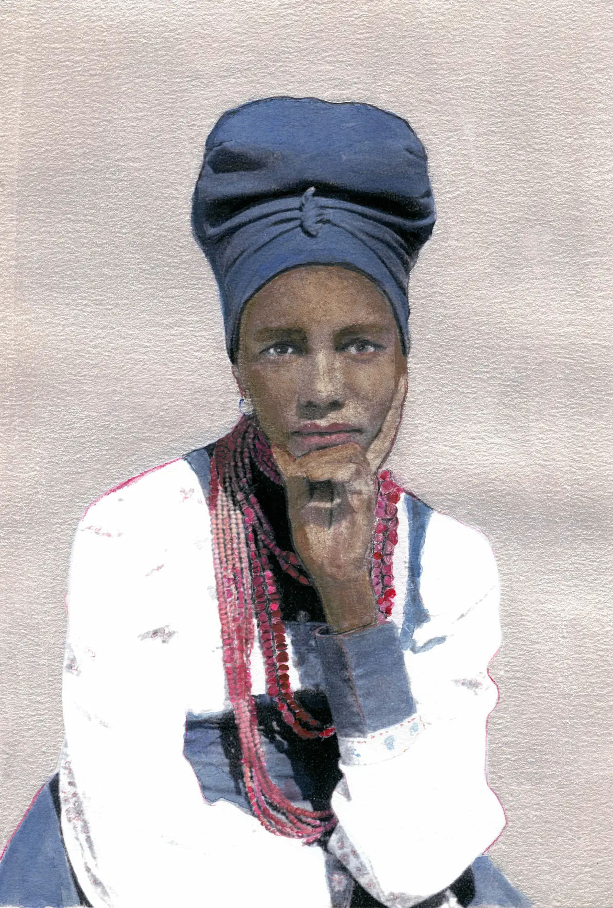

On December 10, we are presenting [a public lecture](https://spui25.nl/programma/echo-travels-re-circulating-historical-voice-recordings-that-speak-of-colonial-history) by Anette Hoffmann, entitled “Echo Travels: Re-Circulating Historical Voice Recordings That Speak of Colonial History.” It is the second installment of our lecture series “New Directions in Sonic History.” Holden Carroll will moderate the Q&A after the talk, which will be followed by a reception.

 
**Time**: 20:00  
**Location**: Spui 25, 1012 WX Amsterdam  
**Registration**: [https://spui25.nl/programma/echo-travels-re-circulating-historical-voice-recordings-that-speak-of-colonial-history](https://spui25.nl/programma/echo-travels-re-circulating-historical-voice-recordings-that-speak-of-colonial-history)  
**More information**: [echo-travels.org](https://echo-travels.org/)

<figure style="text-align: center;">
    

        
        © Anette Hoffmann
    

</figure>

 

#### Abstract
Historical voice recordings made with African speakers offer ways of listening to colonial histories. Echo Travels, an art project by Anette Hoffmann and Rosemary Lombard, re-introduces speakers whose voices were recorded in projects of colonial knowledge production. It facilitates listening in public spaces by re-assembling the speaker’s dispersed audio-visual archival traces, re-activating their photographic portraits, re-translating their spoken words and attending to historical context. To re-circulate these lesser-known takes on colonial history, the project creates mobile exhibition elements: lightly travelling, sounding posters accompanied by side texts.

#### Biography
Anette Hoffmann is an artist, curator and researcher. Her work engages with historical sound archives and audio-visual collections as sources of colonial history (see [anettehoffmann.com](https://anettehoffmann.com/) and [echo-travels.org](https://echo-travels.org/)). Her recent books are *Knowing by Ear: Listening to Voice Recordings with African Prisoners of War in German Camps (1915-1918)* (Duke University Press, 2024) and *Listening to Colonial History* (BAB, 2023).
